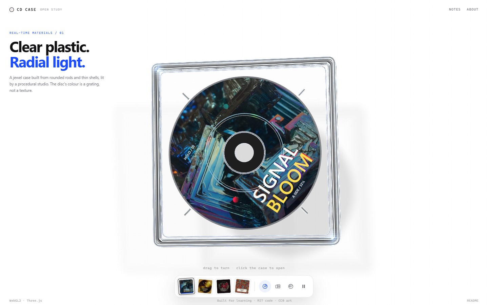
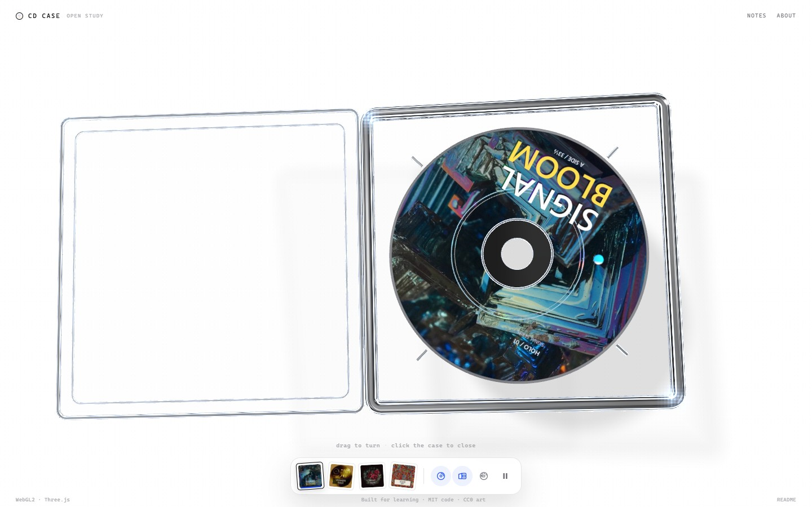
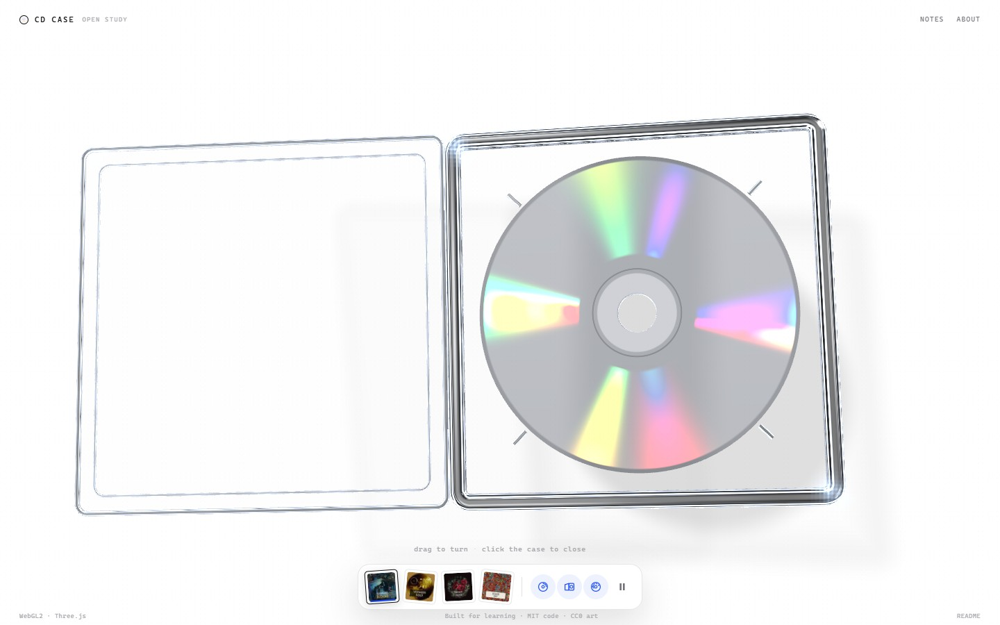

# Open CD Case

A clear CD jewel case in WebGL2: refracted plastic, a radial diffraction grating, a procedural studio, and a small HUD that lets you open the case, spin the disc, and flip it to the silver data side.

This is a **independent, open-source re-implementation** built for learning. The code and visual direction are based on a public WebGL material study; the implementation here is a new rewrite, and every original image has been replaced with openly licensed source material.



## Quick start

No build step and no npm install are required.

**Windows:** double-click `start.bat`.

**macOS / Linux:**

```bash
./start.sh
```

**Or use any static server:**

```bash
python3 -m http.server 8137
# then open http://127.0.0.1:8137/
```

The project also works on GitHub Pages: everything is relative and static.

Requires a browser with **WebGL2** (current Chrome, Edge, Firefox or Safari).

## Controls

| Action | Input |
| --- | --- |
| Turn the case | drag on the canvas |
| Open / close | click the case, the open button, or `O` |
| Previous / next disc | `←` / `→`, or the thumbnails |
| Spin / stop | `S` or the spin button |
| Flip label ↔ data side | `F` or the flip button |
| Pause | `Space` or the pause button |
| Close the About panel | `Esc` |

The first open animation is automatic; interacting stops the auto-demo.

## What is actually rendered

- **Plastic case** — the outer frame, hub rings and hinge are swept rounded rods. The window and tray back are thin shells. Rods are drawn as opaque solids but trace refracted rays through their rounded cross-section at run time; shells use a thin double-surface Fresnel approximation. No normal maps, no transparency sorting, no HDR environment.
- **Studio** — a 512² × 6 procedural cube map (white cyclorama, black flags, strip lights, very bright pin lights) is baked once at startup. The same light design drives reflections, refraction and the star pass.
- **Disc** — a three-faced disc (print, silver data side, rim). The colour comes from a radial grating approximation: the radial half-vector chooses a wavelength, three diffraction orders are summed, and an anisotropic lobe stretches the strip-light highlights along the radius.
- **Data side** — press `F`: the disc rotates to the silver side, with a simplified rainbow and concentric data-track shading.
- **Star pass** — glints above 1.0 are stored in the alpha channel, extracted at half resolution, blurred, and composited back with a cool tint so they remain visible on a white page.
- **HUD** — responsive HTML/CSS; thumbnails, keyboard access, reduced-motion support, and a small About/credits panel.





The technical notes in [TECHNICAL.md](TECHNICAL.md) explain the shader maths and the render pipeline, including where this implementation deliberately differs from the original.

## Project layout

```text
├─ index.html
├─ styles.css
├─ server.js               zero-dependency local server
├─ start.bat / start.sh
├─ src/
│  ├─ main.js              boot + UI wiring
│  ├─ scene.js             geometry, render targets, animation
│  ├─ geometry.js          rounded-profile sweep, plates, disc
│  ├─ materials.js         ShaderMaterial setup
│  ├─ config.js            dimensions, disc catalogue
│  ├─ ui.js                HUD, keyboard, About panel
│  └─ shaders/
│     ├─ common.js         studio lighting + Fresnel
│     ├─ rod.js            plastic rod transmission
│     ├─ sheet.js          thin plastic shell
│     ├─ disc.js           print / gold / vinyl / data side
│     ├─ room.js           procedural cube map
│     ├─ background.js     paper + analytic contact shadow
│     └─ post.js           star extraction / blur / final
├─ assets/
│  ├─ covers/
│  │  ├─ cover-*.webp          final composite covers (CC0 design)
│  │  ├─ *-thumb.webp
│  │  └─ source-textures/      open-license source images
│  ├─ CREDITS.md
│  └─ favicon.svg
├─ tools/
│  └─ make-covers.py / compose-covers.py
├─ vendor/
│  ├─ three.module.js       Three.js r160.1
│  └─ three-LICENSE.txt
├─ docs/
├─ LICENSE                  MIT (code)
└─ TECHNICAL.md
```

## Regenerating the covers

The final covers are composed from openly licensed source textures plus original
typography and vector marks:

```bash
python tools/compose-covers.py
```

`tools/make-covers.py` is kept as an alternative, fully procedural cover pipeline
with no external imagery. It requires Python 3, Pillow and numpy.

## Licenses and credits

- **Code:** MIT. See [LICENSE](LICENSE).
- **Cover composites:** original design work, released as CC0 to the extent
  permitted. The four source images retain their own public-domain
  or CC0 status; full source URLs and attribution are in
  [assets/CREDITS.md](assets/CREDITS.md).
- **Three.js r160.1:** MIT; license in `vendor/three-LICENSE.txt`.
- **Source and inspiration:** the public material study at
  [bubbbly.com/cd-case](https://www.bubbbly.com/cd-case) by Ann Nguyen /
  TypingMind Motion. The code and shader ideas in this project were inspired by that public study;
  the implementation here is a new rewrite, and no original code or
  album art is redistributed. This project is not affiliated
  with or endorsed by the original author.

The spectral fit follows the approach popularised by Alan Zucconi's
“Improving the Rainbow”; the Fresnel approximation is Schlick's. Both are
implemented independently here.
